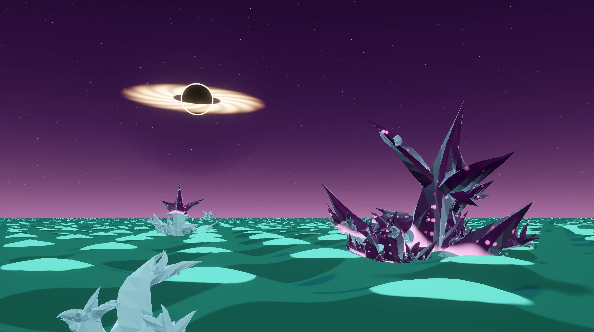
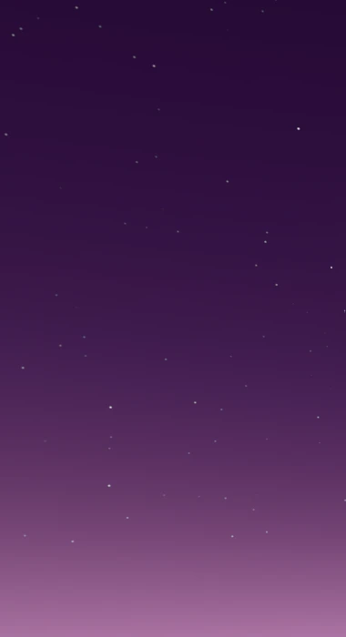
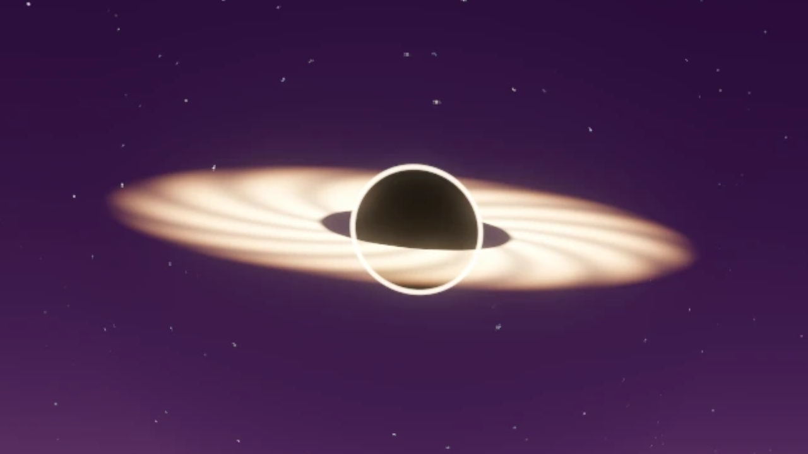
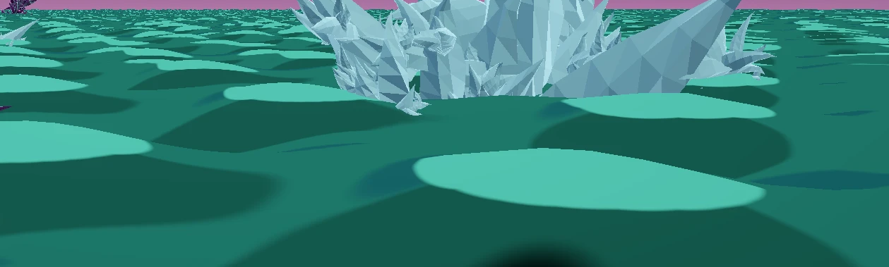
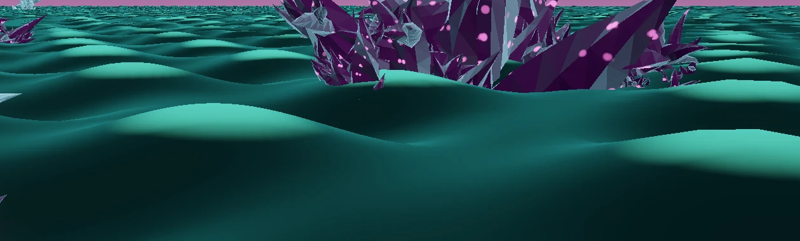
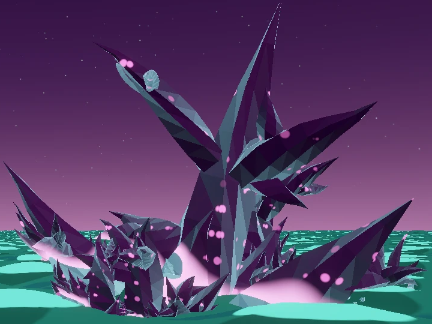
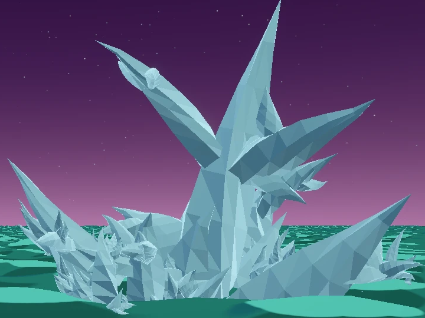
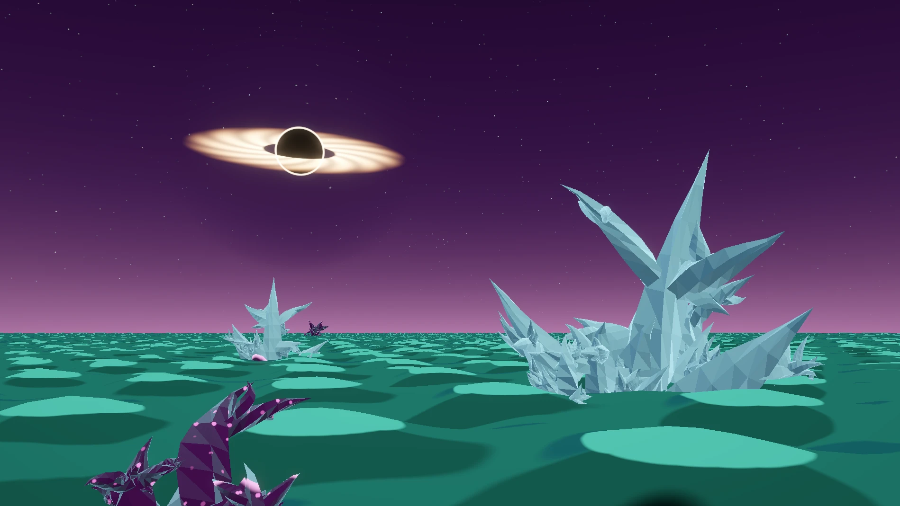

# 블랙홀 아래의 외계 바다

> 나만의 셰이더 제작 과제 제출 문서



블랙홀 근처를 도는 바다 행성입니다. 육지는 없고, 바다에서 솟아오른 외계 수정들이 자기 복제 분자에 잠식되었다가 회복되기를 반복합니다. 하늘 저편의 블랙홀은 뒤쪽 하늘을 휘게 만듭니다.

## 확인 방법

| 항목 | 내용 |
| --- | --- |
| 데모 씬 | `Assets/00. Scenes/MyShader_AlienOcean.unity` |
| 셰이더 폴더 | `Assets/02. MyShaders/` |
| 필요한 설정 | URP 에셋(`Assets/Settings/PC_RPAsset`)의 **Opaque Texture** 켜기. 블랙홀 렌즈에 필요하며 켜 둔 상태로 제출합니다. 같은 이유로 **Opaque Downsampling** 은 None 으로 바꿨습니다 (2배 축소면 휘어진 별이 흐려짐) |
| 재생 | Play 하지 않아도 씬 뷰와 게임 뷰에서 바로 움직입니다 (`_Time` 사용) |

## 셰이더 목록

| # | 셰이더 | 분야 | 핵심 기법 | 바탕으로 한 갤러리 항목 |
| --- | --- | --- | --- | --- |
| 01 | `MyShaders/AlienSky` | 스카이박스 | 방향 벡터 그라데이션, 격자 난수로 절차적 별 | (직접 제작) |
| 02 | `MyShaders/BlackHole` | 3D 투명 판 | SDF 원과 고리, 화면 사진(Opaque Texture)을 휘어 읽는 렌즈 | F1 SDF 도형, D3 충격파 왜곡 |
| 03 | `MyShaders/AlienOcean` | 3D 메시 | 정점 애니메이션(사인파), 법선 재계산, 툰 단계화 | C1 물결 수면, A1 램프 툰 조명 |
| 04 | `MyShaders/ReplicatingCrystal` | 3D 메시 | 프레넬 림, 노이즈 경계 2개, 세포 분열 무늬 | A2 프레넬 림 빛, B1 디졸브 |

네 셰이더는 그리는 대상(하늘, 판, 움직이는 바다, 고정된 물체)과 기법(방향, 화면 공간, 정점, 노이즈 패턴)이 모두 다릅니다.

---

## 먼저 알아 두면 좋은 것

셰이더는 **픽셀 하나하나마다 실행되는 작은 함수**입니다. 모든 셰이더에 아래 두 함수가 있습니다.

- **정점 셰이더(`vert`)**: 메시의 꼭짓점을 화면 위치로 옮깁니다. 바다처럼 꼭짓점을 직접 움직이는 일도 여기서 합니다.
- **픽셀 셰이더(`frag`)**: "이 픽셀은 무슨 색인가?"에 답합니다. 대부분의 효과는 여기서 만듭니다.

자주 나오는 함수는 아래와 같습니다.

| 함수 | 뜻 |
| --- | --- |
| `lerp(A, B, t)` | t 가 0 이면 A, 1 이면 B, 그 사이는 섞은 값 |
| `smoothstep(a, b, x)` | x 가 a 이하면 0, b 이상이면 1, 사이는 부드럽게 0 → 1 |
| `step(a, x)` | x 가 a 이상이면 1, 아니면 0 (딱 끊김) |
| `saturate(x)` | x 를 0~1 로 자르기 |
| `frac(x)` | 소수 부분만 남기기 (0 → 1 을 끝없이 반복) |
| `dot(A, B)` | 두 방향이 같으면 1, 직각이면 0, 반대면 -1 |
| `length(v)` | 원점에서의 거리 |

바다와 수정 머티리얼에는 **단계 보기** 드롭다운이 있습니다. 계산 중간값(높이, 법선, 프레넬 등)을 화면에 띄워 아래 설명을 직접 확인할 수 있습니다.

---

## 01. AlienSky: 외계 행성의 하늘



**한 줄 요약**: 보는 방향 하나만으로 그라데이션, 수평선 빛, 반짝이는 별을 그리는 스카이박스입니다.

### 동작 원리

스카이박스는 카메라를 감싼 아주 큰 공입니다. 공의 한 점은 카메라에서 바라본 **방향** 하나와 같습니다. 그래서 이 셰이더는 위치 대신 방향 벡터 `dir` 만으로 색을 정합니다.

1. **그라데이션**: `dir.y` 는 위가 1, 수평선이 0, 아래가 -1 입니다. `pow(dir.y, GradientPower)` 로 곡선을 휘어서 수평선 색에서 하늘 꼭대기 색으로 섞습니다.
2. **수평선 빛**: `exp(-|dir.y| × Sharpness)` 는 수평선(0)에서 1 이고, 멀어질수록 빠르게 0 이 됩니다. 수평선에 얇게 번지는 대기 빛이 됩니다.
3. **별**
   - 방향에 밀도를 곱해 3D 공간을 큰 격자로 나눕니다. `floor` 로 몇 번째 칸인지, `frac` 으로 칸 안의 위치를 구합니다.
   - 칸마다 난수로 ① 별이 있는지 ② 별의 위치 ③ 밝기·색·반짝임 박자를 정합니다. 같은 칸은 항상 같은 난수라서 별이 제자리에 있습니다.
   - 픽셀이 별 위치에 가까울수록 밝게 칠하고, 별마다 다른 속도의 `sin` 으로 반짝이게 합니다.
   - 수평선 근처는 `smoothstep` 으로 별을 지워, 두꺼운 대기 때문에 흐려지는 느낌을 냅니다.

### 프로퍼티

| 프로퍼티 | 하는 일 |
| --- | --- |
| Zenith / Horizon / Ground Color | 하늘 꼭대기, 수평선, 수평선 아래 색 |
| Gradient Power | 클수록 수평선 색이 위쪽까지 넓게 퍼짐 |
| Glow Color / Intensity / Sharpness | 수평선 빛의 색, 세기, 두께 |
| Star Density / Probability / Size | 격자 촘촘함, 칸에 별이 있을 확률, 별 크기 |
| Star Brightness / Color A·B | 별 밝기와 두 가지 색 |
| Twinkle Speed | 반짝임 속도 |
| Star Horizon Fade | 수평선 근처에서 별이 흐려지는 폭 |

### 직접 만든 부분

갤러리에 스카이박스 항목이 없어서 처음부터 만들었습니다. 별이 칸 경계에서 잘리지 않도록 별 위치를 칸의 0.2~0.8 범위에 두고, 그래서 별 크기의 최댓값을 0.2 로 제한했습니다.

---

## 02. BlackHole: 멀리 떠 있는 블랙홀



**한 줄 요약**: 판 한 장 위에 그림자, 빛 고리, 도는 강착원반을 그리고, 뒤쪽 하늘을 돋보기처럼 휘게 합니다.

### 동작 원리

핵심은 **r = 이 픽셀이 블랙홀 중심에서 얼마나 떨어져 있나** 하나입니다. 판의 UV(0~1)를 `uv × 2 - 1` 로 바꾸면 중심이 0, 가장자리가 1 이 됩니다.

화가처럼 **뒤에 있는 것부터** 칠합니다.

1. **렌즈**: URP 는 하늘과 불투명 물체를 다 그린 뒤 그 화면을 사진처럼 복사해 둡니다(Opaque Texture). 블랙홀은 투명 물체라 그 뒤에 그려지므로, 이 사진을 가져와 쓸 수 있습니다. 사진을 읽는 위치를 중심 쪽으로 당기면 가운데 하늘이 크게 늘어나 보입니다.
   ```hlsl
   float pull = _LensStrength * (1.0 - saturate(r));     // 가운데일수록 많이, 가장자리는 0
   float3 col = SampleSceneColor(lerp(screenUV, centerUV, pull));
   ```
2. **원반 뒤쪽 절반**: 원반은 누워 있어 납작한 타원으로 보입니다. `y` 를 기울기로 나누면 타원이 원으로 펴집니다. 화면 위쪽 절반(`p.y > 0`)은 블랙홀 뒤를 지나므로 먼저 그립니다.
3. **그림자**: `r` 이 반지름보다 작은 곳에 0 을 곱해 검게 칠합니다. 방금 그린 원반 뒤쪽도 여기서 가려집니다.
4. **빛 고리**: `1 - smoothstep(0, 두께, abs(r - 반지름))` 은 테두리 위에서만 1 인 얇은 고리입니다(SDF 고리).
5. **원반 앞쪽 절반**: 그림자를 다 칠한 뒤에 더하므로, 검은 원 위로 원반이 지나가 보입니다.

원반의 줄무늬는 `atan2` 로 구한 각도에 `sin(각도 × 개수 + 거리 × 20 - 시간)` 을 써서 소용돌이처럼 돌게 했습니다.

### 프로퍼티

| 프로퍼티 | 하는 일 |
| --- | --- |
| 그림자 크기 | 검은 원의 반지름 |
| 렌즈 세기 | 뒤쪽 하늘이 휘는 정도 |
| 빛 고리 색 / 두께 | 그림자 테두리 링 |
| 원반 안쪽·바깥쪽 색 | 안쪽(뜨거움)은 흰색, 바깥은 주황 |
| 원반 안쪽·바깥쪽 반지름 | 원반이 차지하는 범위 |
| 원반 기울기 | 작을수록 옆에서 본 듯 납작 |
| 원반 도는 속도 / 줄무늬 개수 | 소용돌이 움직임 |

### 갤러리에서 바꾸거나 더한 부분

- **D3 충격파 왜곡**은 고리 하나만 바깥으로 밉니다. 여기서는 **원 전체를 안쪽으로 당겨** 중력 렌즈처럼 보이게 했습니다.
- D3 은 화면 전체에 거는 후처리지만, 여기서는 **판 한 장 위에서만** 휘게 했습니다. D3 은 화면이 가로로 길어서 화면비를 곱하지만, 판의 UV 는 정사각형이라 필요 없습니다.
- **F1 SDF** 의 원과 고리를 겹쳐 그림자, 빛 고리, 원반을 만들고, 앞뒤 절반을 나눠 그리는 순서로 입체감을 냈습니다.

### 흔한 실수

- **렌즈 부분이 회색이나 검은색**: Opaque Texture 가 꺼져 있습니다. URP 에셋에서 켭니다.
- **줄무늬가 한 곳에서 끊김**: `atan2` 각도는 한 바퀴 돌 때 -π 에서 π 로 튑니다. 줄무늬 개수를 `round` 로 정수로 만들어야 이음매가 사라집니다.

---

## 03. AlienOcean: 만화풍 외계 바다



밝은 청록 조각이 광원(Directional Light)을 향한 물결 면, 짙은 청록이 등진 면입니다. 경계가 부드러운 그라데이션 없이 딱 끊겨 만화처럼 보입니다.

<!-- 툰 섞기 = 0 (갤러리 C1 그대로) 비교 샷을 찍으면 아래 표로 바꾸세요.
| 툰 섞기 = 0 (갤러리 C1 그대로) | 툰 섞기 = 1 (완성) |
| --- | --- |
|  |  |
-->

**한 줄 요약**: 사인파로 출렁이는 바다(C1)에 툰 단계화(A1)를 섞어, 빛을 향한 물결만 밝은 띠가 되는 만화풍 바다입니다.

### 동작 원리

**1단계: 파도 (정점 셰이더)**

방향과 파장이 다른 사인파 3개를 더해 정점의 높이를 바꿉니다. 방향을 엇갈려야 골판지처럼 한 줄로 늘어서지 않습니다.
```hlsl
높이 = 진폭 × sin( (2π / 파장) × (파도 방향 · 위치) - 시간에 따라 밀리는 양 )
```

**2단계: 법선 다시 구하기**

정점을 움직였으면 법선도 다시 구해야 빛이 물결을 따라 생깁니다. `sin` 을 미분하면 `cos` 이라 기울기가 바로 나오고, 기울기가 `(dx, dz)` 인 면의 법선은 `(-dx, 1, -dz)` 방향입니다.

**3단계: 툰으로 칠하기**

| 요소 | 원리 |
| --- | --- |
| 물빛 띠 | `1 - dot(법선, 시선)` (비스듬할수록 1) 을 띠로 끊어 짙은 물 → 밝은 물 색 띠로 칠함 |
| 빛 띠 | `dot(법선, 빛)` 을 띠로 끊음. 광원을 향한 물결 면만 밝은 띠가 되고, 등진 면은 그늘 색으로 물듦 |
| 툰 반사광 | 반사광이 기준값을 넘은 곳만 켬 → 경계가 또렷한 반짝임 조각 |
| 툰 거품 | 파도 높이가 기준을 넘은 마루만 1 → 또렷한 발광 거품, `sin` 으로 천천히 깜빡임 |

"띠로 끊기"는 A1 에서 가져온 함수입니다. 0~1 값을 띠 수만큼의 계단으로 만들고, 경계만 살짝 부드럽게 해서 지글거림을 막습니다.
```hlsl
float t = value * bands - 0.5;
float stepped = floor(t) + smoothstep(0.5 - w, 0.5 + w, frac(t));   // 계단 + 경계만 부드럽게
return saturate(stepped / (bands - 1.0));
```

### 프로퍼티

| 프로퍼티 | 하는 일 |
| --- | --- |
| 파도 높이 / 파장 / 속도 / 방향 | 첫 파도의 값. 나머지 두 파도는 일정 비율로 따라감 |
| 물빛 / 하늘빛 / 그늘 색 | 물 색 띠의 양 끝과, 광원을 등진 물결의 색 |
| **툰 섞기** | 0 = 갤러리 C1 의 매끈한 물, 1 = 툰. 둘을 비교할 수 있음 |
| 띠 수 / 띠 경계 부드러움 / 그늘 넓이 | 툰 단계 조절 |
| 반사광 세기 / 날카로움 / 툰 반사광 기준값 | 반짝임 조각의 밝기와 크기 |
| 거품 발광 색 / 시작 높이 / 깜빡임 속도 | 마루 거품 |
| 단계 보기 | Height, Normal, Fresnel, WaterBand, LightBand, Specular, Foam |

### 갤러리에서 바꾸거나 더한 부분

- **두 항목을 섞음**: C1 물결 수면의 파도와 법선 위에 A1 램프 툰 조명의 띠 끊기를 얹었습니다.
- **툰 물빛**: C1 은 프레넬로 물빛과 하늘빛을 부드럽게 섞습니다. 실제 프레넬 식은 대부분 0 근처라 띠가 거의 생기지 않아서, 더 고르게 퍼진 `1 - dot(법선, 시선)` 을 띠로 끊었습니다.
- **툰 반사광과 툰 거품**: 갤러리에 없는 부분으로 직접 더했습니다.
- **툰 섞기 슬라이더**: 원본과 바꾼 결과를 한 머티리얼에서 비교하게 했습니다.
- **반투명 → 불투명**: 바닥이 비칠 필요가 없는 넓은 바다라서 알파를 없앴습니다. 덕분에 바다가 깊이를 기록해 뒤의 블랙홀을 제대로 가립니다.
- **크기**: 10 m 호수에서 수평선까지 닿는 바다로 키웠습니다. `AlienOceanGrid.cs` 의 `centerDensity` 로 카메라 근처는 촘촘하고 수평선 쪽은 성긴 격자를 만들어, 칸 수를 늘리지 않고 넓은 바다를 덮었습니다.

### 흔한 실수

- **출렁이는데 평평한 판처럼 빛남**: 정점만 밀고 원래 평면 법선(위쪽)을 그대로 쓴 경우입니다. 법선을 파도 기울기로 다시 구해야 합니다.
- **파도가 각진 선**: Unity 기본 Plane 은 10칸이라 정점이 너무 성깁니다. 촘촘한 격자(`AlienOceanGrid`)를 씁니다.
- **오래 켜 두면 파도가 떨림**: `_Time` 이 커지면 소수 정밀도가 떨어집니다. 위상을 `frac` 으로 한 주기 안에 감쌉니다.

---

## 04. ReplicatingCrystal: 자기 복제 분자에 잠식되는 수정

| 감염된 상태 | 회복된 상태 |
| --- | --- |
|  |  |

| 전체 장면: 오른쪽 무리가 감염된 순간 | 같은 시점: 오른쪽 무리는 회복되고 앞쪽 수정이 감염됨 |
| --- | --- |
|  |  |

두 장면은 같은 카메라, 같은 머티리얼입니다. 수정마다 놓인 위치로 시작 시점이 달라서 서로 다른 단계에 있습니다(아래 6번 군체 연출). 감염된 곳의 분홍 점이 분열하는 분자이고, 경계 근처의 밝은 띠가 경계 발광입니다.

**한 줄 요약**: 빛나는 경계가 아래에서 위로 올라가며 수정을 감염시키고, 감염된 곳에서는 분자가 둘로 갈라지기를 반복합니다. 뒤따르는 회복 경계가 다시 아래에서 위로 쓸어 올려 수정을 되돌립니다.

### 동작 원리

UV 대신 **오브젝트 공간 위치**를 씁니다. 받아 온 메시의 UV 가 엉망이어도 무늬가 깨지지 않습니다.

1. **조명**: `dot(법선, 빛)` 으로 빛을 받는 면을 밝게 하고, `SampleSH` 로 하늘에서 오는 은은한 환경광을 더합니다.
2. **림 (A2)**: `pow(1 - dot(법선, 시선), 지수)` 는 정면에서 0, 윤곽에서 1 입니다. 지수가 클수록 윤곽 근처만 남아 얇은 림이 됩니다.
3. **감염 경계 2개 (B1 응용)**
   - 경계 A(감염)가 바닥에서 꼭대기로 올라간 뒤, 경계 B(회복)가 뒤따라 올라갑니다.
   - **A 보다 아래이면서 B 보다 위**인 곳만 감염 상태입니다.
   - 경계 높이에 3D 노이즈를 더해 울퉁불퉁하게 만듭니다. 곧은 선이면 기계처럼 보입니다.
   ```hlsl
   float riseA = saturate(cycle * 2.0);         // 앞 절반 동안 0 → 1
   float riseB = saturate(cycle * 2.0 - 1.0);   // 뒤 절반 동안 0 → 1
   float infected = step(0.0, dA) * step(0.0, dB);
   ```
4. **경계 발광 (B1)**: 경계 바로 안쪽의 좁은 띠만 1 로 만들어 발광 색으로 덮습니다.
5. **세포 분열**
   - 공간을 작은 정육면체 칸으로 나누고, 칸 가운데 점(분자)을 둡니다.
   - 시간이 지나면 점이 좌우로 갈라져 두 개가 됩니다.
   - 칸마다 난수로 시작 시점을 다르게 해서 한꺼번에 갈라지지 않게 하고, `sin(cycle × π)` 로 반복의 시작과 끝에서 점이 툭 튀지 않게 합니다.
6. **군체 연출**: 수정의 월드 위치로 시작 시점을 다르게 해서, 여러 개를 놓으면 서로 다른 단계에 있게 됩니다.

### 프로퍼티

| 프로퍼티 | 하는 일 |
| --- | --- |
| 수정 색 / 림 색 / 림 좁히기 / 림 세기 | 순수한 수정의 모습 |
| 수정 바닥·꼭대기 높이 | 경계가 오르내리는 범위 (오브젝트 y) |
| 번지는 속도 / 시작 시점 밀기 | 감염 → 회복 한 바퀴의 빠르기와 시작 시점 |
| 경계 울퉁불퉁 크기·세기 | 경계 모양 |
| 경계 발광 색 / 두께 | 경계 띠 |
| 감염된 수정 색 / 분자 색 | 감염된 곳의 모습 |
| 분자 촘촘함 / 크기 / 분열 속도 | 세포 분열 무늬 |
| 단계 보기 | Lighting, Rim, Infected, Edge, Cells |

### 갤러리에서 바꾸거나 더한 부분

- **B1 디졸브**는 경계 너머를 **지워서** 구멍을 냅니다. 여기서는 지우지 않고 **다른 재질로 바꿉니다**(감염).
- 임계값 슬라이더 대신 경계가 **시간에 따라 스스로** 움직이고, 경계를 **두 개**(감염, 회복)로 늘렸습니다.
- **세포 분열 무늬**와 **위치 기반 군체 연출**은 직접 더했습니다.
- **A2 프레넬 림**을 수정 본체의 반짝이는 테두리로 썼습니다.

### 개발 중 겪은 문제와 해결

처음에는 경계 하나를 `frac(시간)` 으로 올렸습니다. `frac` 은 1 에서 0 으로 한 프레임 만에 튀기 때문에, **경계가 꼭대기에 닿는 순간 다 감염된 수정이 갑자기 깨끗한 색으로 바뀌는** 버그가 생겼습니다.

회복도 경계로 아래에서 위로 쓸어 올리게 바꿨습니다. `cycle` 이 1 에서 0 으로 튀는 순간에는 두 경계 모두 수정 바깥에 있어서 화면에 변화가 없습니다.

---

## 장면 연출

| 요소 | 연출 의도 |
| --- | --- |
| 구도 | 3분할 구도입니다. 수평선은 아래 1/3, 블랙홀은 왼쪽 위, 주인공 수정 무리는 오른쪽 1/3 에 둡니다 |
| 조명 | 기본 Directional Light 하나만 씁니다. 툰 바다의 빛 띠와 반짝임, 수정의 음영이 모두 이 빛의 방향을 따릅니다 |
| 수정 배치 | 앞쪽 작은 수정, 중간 무리, 수평선의 거대한 첨탑으로 깊이감을 줍니다. 아랫부분을 물에 묻어 바다에서 솟은 것처럼 보이게 합니다 |
| 색 | 청록 바다와 주황빛 강착원반의 보색 대비, 보랏빛 하늘을 씁니다 |
| 후처리 | Bloom 으로 HDR 발광(원반, 빛 고리, 분자, 거품)을 번지게 합니다 |

## 출처

- **shader-gallery** (수업 제공): C1 물결 수면, A1 램프 툰 조명, A2 프레넬 림 빛, B1 디졸브, D3 충격파 왜곡, F1 SDF 도형을 참고했습니다. 코드는 한 파일로 합쳐 다시 쓰고 주석을 새로 달았습니다.
- **수정 메시**: TODO. 받아 온 곳과 라이선스를 적어 주세요.

---

<!--
스크린샷 체크리스트 (Screenshots/ 폴더에 아래 이름으로 저장)
  (완료) scene_a.webp / scene_b.webp   완성 장면, 수정 감염 단계 비교
  (완료) 01_sky.png, 02_blackhole.png, 03_ocean_toon.png, 04_crystal_*.png   위 두 장면에서 잘라 확대함
  03_ocean_smooth.png   바다, 툰 섞기 = 0 (03_ocean_toon 과 같은 시점) ← 아직 없음
원리 설명을 더 보강하려면 단계 보기(LightBand, Infected 등) 화면도 찍어서 각 단계 옆에 넣으면 좋습니다.
-->
